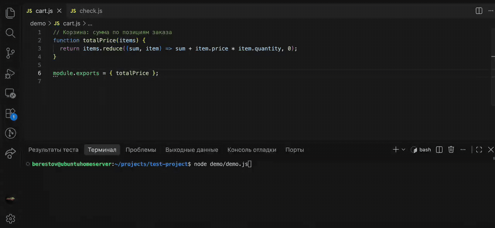
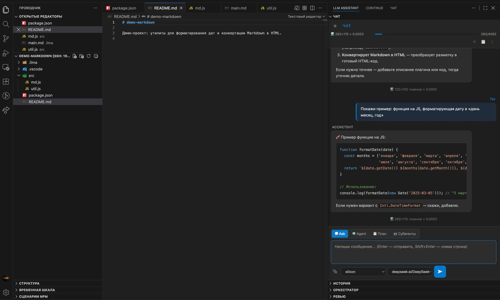
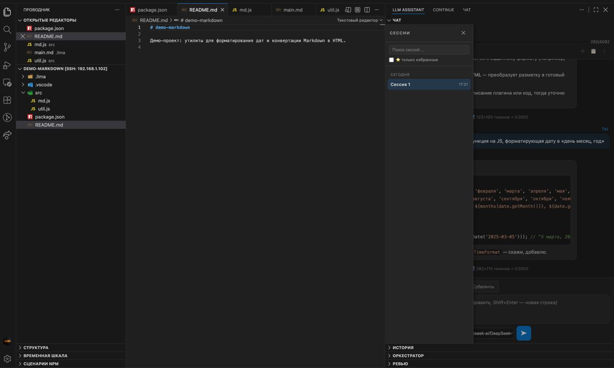
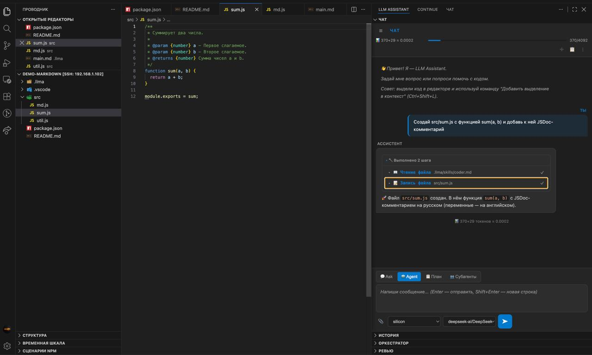
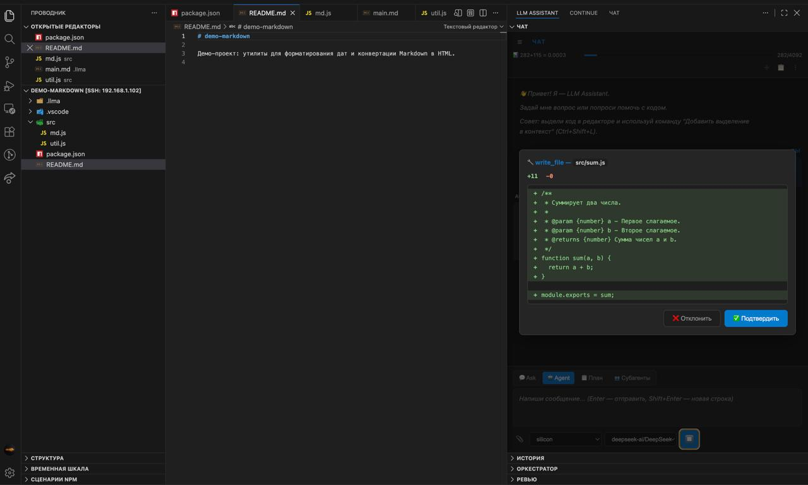
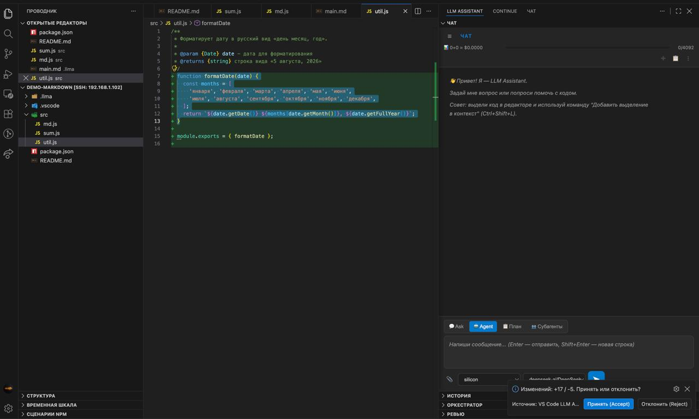
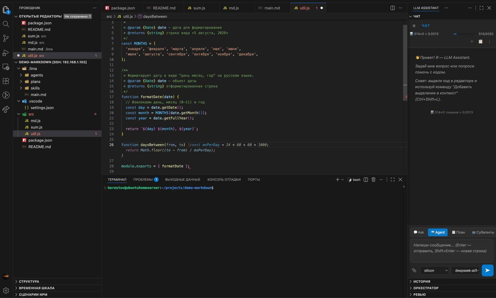
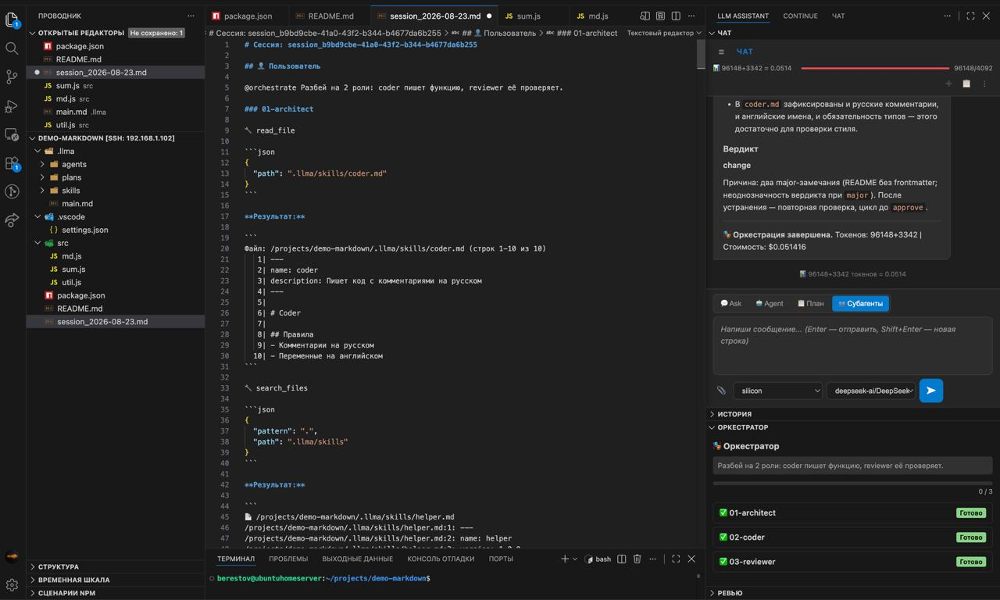

# VS Code LLM Assistant


**AI-агент для VS Code с любым провайдером по своему ключу.** Чат, inline-правки, автокомплит и ReAct-агент с инструментами поверх любого OpenAI-совместимого API — DeepSeek, OpenAI, OpenRouter, SiliconFlow и других.

Локальные модели (Ollama, llama.cpp) — **опция**, а не замена облаку: нужна, когда код не должен покидать машину или важно `$0`. Работает, но качество и скорость задаёт железо — на 8B-моделях это диалог «на подумать», для работы остаётся облачный ключ.

```bash
code --install-extension alekseyber.vscode-llm-assistant
```



| Режим | Клавиши | Назначение |
|-------|---------|-----------|
| 💬 **Chat** | Боковая панель | Чат с контекстом кода, стриминг, индикатор токенов и стоимости |
| ✏️ **Edit** | `Ctrl+Alt+I` / `Cmd+Option+I` (macOS) | Выделил код → инструкция → diff → Accept/Reject |
| ⚡ **Autocomplete** | Tab/Escape | Ghost text на паузе печати |
| 🤖 **Agent** | Вкладка в чате | ReAct-агент с инструментами, MCP, подтверждениями и оркестрацией |

## Почему этот, а не Copilot / Cursor

| | Здесь | Copilot / Cursor |
|---|---|---|
| Работает офлайн | ✅ Ollama или llama.cpp, запросы не покидают машину | ❌ нужен облачный аккаунт |
| Стоимость | твои ключи по прайсу провайдера или `$0` локально | подписка от $10/мес |
| Провайдер | любой OpenAI-совместимый + Ollama | только свой |
| Агент с инструментами | ✅ ReAct, MCP, мультиагент | ✅ (Cursor) |
| Телеметрия | нет | есть |

## Локальные модели (Ollama) — без облака

Тот же чат, агент и автокомплит, но ни один запрос не уходит в интернет. Провайдер работает на **нативном** `/api/chat`: OpenAI-совместимый `/v1` у Ollama не умеет отключать рассуждение, и thinking-модель (`qwen3:8b`) отвечает пустым текстом.

```json
{
  "llmAssistant.providers": {
    "local": {
      "type": "ollama",
      "baseUrl": "http://127.0.0.1:11434",
      "title": "Ollama (локально)",
      "models": []
    },
    "local-llamacpp": {
      "type": "openai",
      "baseUrl": "http://127.0.0.1:8080/v1",
      "apiKey": "",
      "title": "llama.cpp (локально)",
      "models": ["qwen3-8b"]
    }
  }
}
```

- **`models: []`** — список моделей подтянется с сервера (`/api/tags`), вручную прописывать не нужно
- **Проверка сервера:** команда `LLM Assistant: Проверить локальный сервер` — версия, модели, размеры, capabilities (`tools` / `thinking` / `vision`)
- **Стоимость:** локальные модели считаются бесплатными (в статистике токенов `$0`, а не выдуманная цена). Исключение — явная цена в настройках: платный шлюз на `127.0.0.1` (свой прокси к Azure, LiteLLM) считается по прайсу, иначе лимит бюджета обходился бы
- **Vision:** поддержка изображений определяется по capability `vision` из `/api/show`, вручную `supportsVision` задавать не нужно. Если модель без vision — плагин предупредит, что картинка не отправлена
- **Сводка изменений:** каждый агентский прогон заканчивается строкой `📝 Изменено файлов: N` (или `📝 Файлы не изменялись`) — видно, когда модель сказала «готово», не тронув файлы
- **Агентский цикл выключен по умолчанию** (`llmAssistant.local.toolLoop`): модели до 8B выдумывают результаты инструментов вместо чтения — ошибка выглядит как ответ
- **Окно контекста ограничено с двух сторон:** `llmAssistant.local.numCtx` задаёт `num_ctx` запроса, но модель видит `min(numCtx, OLLAMA_CONTEXT_LENGTH сервера)`. Под сам промпт Ollama отдаёт примерно **половину** окна, вторая половина резервируется под ответ: при `num_ctx` 512 сервер обрабатывает 258 токенов, при 4096 — 2050, при 16384 — 8194 (замерено на 0.40.15). Поэтому `num_ctx` надо брать с запасом ×2 к длине промпта. Если промпт упёрся в окно, плагин один раз на модель показывает предупреждение «промпт, вероятно, обрезан» с числом обработанных токенов; значения видны в канале «LLM Assistant» при `llmAssistant.debug = true`. На сервере держите `OLLAMA_NUM_PARALLEL=1`: при нескольких слотах Ollama делит окно между ними, и на запрос остаётся его часть
- **Оба локальных пути полноценные.** Нативный `/api/chat` у Ollama — единственное место, где работают `num_ctx` и `think: false`, поэтому `type: "ollama"` не «старый вариант на выброс», а один из двух равноправных выборов
- **Второй локальный движок рядом с Ollama — без новых ключей.** Всё, что говорит на OpenAI-совместимом `/v1` на loopback (llama.cpp `llama-server`, LM Studio, vLLM), подключается обычной записью провайдера: `"local-llamacpp": { "type": "openai", "baseUrl": "http://127.0.0.1:8080/v1", "apiKey": "", "models": ["qwen3-8b"] }`. Локальность определяется **по адресу**, а не по типу: такой провайдер получает тот же флаг локального и `$0` в статистике
- **Имя в селекторе — из `title`.** Ключ записи машинный (`local-llamacpp`), а рядом в конфиге можно поставить `"title": "llama.cpp (локально)"`; у локального провайдера без `title` плагин сам добавляет «(локально)», чтобы `type: "openai"` на localhost не читался как облачный OpenAI
- **Настройки локального движка можно переопределить в записи провайдера** — `numCtx`, `think`, `timeout` (секунды), `toolLoop`. Приоритет: запись провайдера → глобальная `llmAssistant.local.*` → встроенный дефолт. Нужно, когда локальных движков несколько: у llama.cpp контекст и рассуждение задаются флагами сервера, и глобальный `numCtx` к нему молча не применяется
- **Модели у локального движка подтягиваются сами.** У llama.cpp/LM Studio при `isLocal` плагин читает `GET /v1/models` (кэш 30 с, таймаут 3 с): `models` можно оставить пустым или указать только нужные — список дополнится серверными. У облачных провайдеров discovery не включается: там `/v1/models` отдаёт десятки моделей и затёр бы выбранный набор
- **Что выбрать: Ollama или llama.cpp.** Ollama — если нужен автопоиск моделей (`models: []` подтягивается из `/api/tags`) и не важен холодный старт: после простоя первый ответ ждёт 5–9 секунд на загрузку модели в память. llama.cpp — если важнее быстрый первый токен, `tool_calls` уже в форме OpenAI и строгий JSON по схеме; контекст и рассуждение у него задаются флагами сервера (`--ctx-size`, `--reasoning`), а не настройками плагина — если поставить `numCtx`/`think` в его записи, плагин предупредит, что они не применяются. Скорость генерации на одном и том же железе у обоих движков одинаковая: замерено 11,1 против 10,7 ток/с при prefill 70 против 70
- **Сервер может быть погашен намеренно** (дежурный режим, экономия памяти): тогда запрос вернёт ошибку соединения с подсказкой запустить Ollama — это ожидаемое поведение, а не сбой плагина
- **Ожидаемые скорости на CPU:** `gemma3:4b` — 8 с на короткий ответ, `qwen3:8b` с `think: false` — ~5 с, агентский шаг — до 50 с. Это диалог «на подумать», не замена облаку

## Скриншоты

**Чат-панель** — сайдбар сессий, тулбар, тумблеры режимов (Ask/Agent/План/Субагенты):



**Сайдбар сессий** — поиск, группировка «Сегодня», избранное:



**Агентный режим** — дружелюбные шаги + свёрнутый трейс «🔧 Выполнено N шагов»:



**Подтверждение операций** — инлайн-дифф перед записью файла:



**Edit** — инлайн-дифф предложения правки:



**Autocomplete** — ghost text по мере ввода:



**Субагенты (`@orchestrate`)** — экспорт с группировкой tool-шагов по воркерам:



## Установка

**Из Marketplace:**
```bash
code --install-extension alekseyber.vscode-llm-assistant
```

Или: VS Code → Extensions (`Ctrl+Shift+X`) → найти «LLM Assistant» → Install.

**Из `.vsix` (ручная установка):**
```bash
# ставится самый свежий файл из текущей папки — версию не нужно держать в голове
code --install-extension "$(ls -t vscode-llm-assistant-*.vsix | head -1)" --force
```

**Быстрый старт за 2 минуты — облако (нужен только ключ):**
1. `Ctrl+,` → в `settings.json` добавь провайдера (секция «Полная конфигурация» ниже)
2. Открой чат: иконка плагина в Activity Bar → 💬
3. Напиши сообщение — готово

**Быстрый старт без интернета — локальная модель:**

```
ollama pull gemma3:4b        # ~3.4 ГБ, работает и с картинками
```

```json
{ "llmAssistant.providers": { "local": { "type": "ollama", "baseUrl": "http://127.0.0.1:11434", "models": [] } } }
```

Дальше — `LLM Assistant: Проверить локальный сервер` в палитре, провайдер `local` в панели чата. Ни ключей, ни регистрации, ни отправки кода наружу.

## Возможности

### 🤖 Агентный кодинг
- **ReAct-агент** с инструментами: `read_file`, `write_file`, `replace_in_file`, `patch_file`, `list_files`, `search_files`, `run_terminal`, `web_fetch`, `ask_user`, `delegate_to_agent`
- **Подтверждение операций** перед записью/изменением файлов (с git-diff `+N −M`)
- **Allow-list инструментов** через настройки или `.vscode/llm-assistant.json`
- **Ход выполнения**: структурированные сворачиваемые шаги по тулам

### 📋 Plan Mode
- Переключатель «📋 Plan» в Agent-режиме — план перед кодом
- **Три этапа:** планирование → имплементация → рефлексия
- Результат (план/имплементация/рефлексия) персистится в сессию
- **AgentOrchestrator** (architect → coder) реализует план, **ReviewerAgent** проверяет каждый AC

### 🔍 Standalone AI-ревью
- Команда «LLM Assistant: Review File» — ревью активного файла или выделения
- Структурированный отчёт: стиль / безопасность / корректность / оптимизация
- Компактная сводка в сайдбаре → широкое окно с полным отчётом
- Правила из `.llma/agents/reviewer.md` подхватываются автоматически

### ⚡ Слэш-команды
- `/explain`, `/doc`, `/test`, `/review`, `/improve` (+ `/explain_stepbystep`) — по выделенному коду
- Автокомплит при вводе `/` или `@`: встроенные команды + скилы из `.llma/skills/` + `@orchestrate`

### 🎭 Multi-Agent (`@orchestrate`)
- Цепочка агентов **architect → coder → reviewer** (роли настраиваются в `.llma/agents/`)
- **3 стратегии**: `sequential`, `parallel`, `pipeline`
- Вкладка «Оркестратор»: дерево воркеров со статусами, прогресс, детали по клику
- **SharedContext**: обмен артефактами между воркерами

### 🗂 Каталог скилов (`.llma/skills/` и `.claude/skills/`)
- Агент видит доступные скилы в system prompt, вызов через `/skill` или `/имя-скила`
- Читаются оба формата: `.llma/skills/<имя>.md` и `.claude/skills/<имя>/SKILL.md`; при совпадении имён приоритет у `.llma`
- В таблице каталога есть колонка «Файл» — агент читает фактический путь, а не угадывает его
- Каталог ограничен 6 000 знаками: не влезшие скилы не молчат, а помечаются
- Frontmatter: `name`, `version`, `tools`, `description`

### 🔌 Совместимость с чужими конвенциями
- **Правила проекта** читаются из `AGENTS.md`, затем `.llma/main.md`, затем `CLAUDE.md` — в этом порядке, с подписями источников. Лимит `agentsMd.maxChars` (12 000), лишнее обрезается с пометкой
- **Роли** `@orchestrate` — из `.llma/agents/*.md` или `.claude/agents/*.md`; поле `tools` из frontmatter ограничивает набор инструментов роли по белому списку
- **Команда `LLM Assistant: Показать источники правил`** — отчёт: какие файлы прочитаны, сколько знаков, что отрезано, какие скилы и роли найдены. Без содержимого и абсолютных путей

### 💰 Бюджет и выбор модели
- **Прогноз стоимости** перед каждым запросом: вход по фактическому контексту, выход `maxTokens × 0.3`; для локальных моделей — $0
- **Лимит сессии** `budget.sessionLimitUsd`: при превышении — вопрос с числами (лимит, потрачено, прогноз, перерасход); отказ отменяет запрос **до** отправки в модель
- **Дневной лимит** `budget.dailyLimitUsd`: считается по факту, переживает перезапуск окна и не обнуляется новой сессией; снимается командой «LLM Assistant: Сбросить дневной лимит бюджета»
- **Стоп внутри прогона**: агентский цикл проверяет деньги на каждом шаге — длинный ReAct-прогон больше не пробивает лимит, прогон останавливается со статусом «лимит»
- **Агент считается по шагам**: прогноз умножается на `agent.maxIterations`, иначе лимит обходится ReAct-циклом
- **Авто-выбор модели** `routing.auto` (по умолчанию выключен): простые задачи → `routing.simpleModel`, сложные → `routing.complexModel`. Сложно = агент, Plan Mode, контекст > 6 000 токенов, текст > 1 500 знаков или маркеры («рефактор», «почему», «баг»). Явный выбор в панели не переопределяется

### 🏗 Harness-слои агента
- **Правила проекта** — автоинжект из `AGENTS.md` / `.llma/main.md` / `CLAUDE.md`
- **Context Summary** — сжатие старых сообщений при переполнении контекста
- **Ретраи + таймауты** — exponential backoff при 429/5xx/сетевых ошибках
- **MCP-клиент** — внешние инструменты через Model Context Protocol (stdio)
- **Защита от prompt injection** — результат `web_fetch` и MCP приходит модели в размеченном блоке «это данные, а не инструкции»; попытки перехвата команд и выманивания ключей (`.env`, `apiKey`, `~/.ssh`, `curl … | sh`) помечаются предупреждением
- **Поиск с ранжированием** — `search_files` учитывает `.gitignore`, не обрывается на 500 файлах, поднимает объявления символов выше случайных вхождений
- **Run History Dashboard** — вкладка «История» с таблицей всех запусков и фильтром по режиму (Чат / Агент / Edit); сводка над таблицей: суммарная и средняя стоимость, доля ошибок. Двойной клик по строке — детали прогона (провайдер, модель, шаги, токены, длительность). В деталях — **прогноз против факта** (и процент от прогноза) и пометка «авто» с причиной, если модель подобрал роутер по сложности задачи

### Прочее
- **Мульти-провайдер**: DeepSeek, Hermes, SiliconFlow, OpenAI и любые OpenAI-совместимые API
- **Vision**: анализ изображений у **любого** провайдера, который умеет картинки — облачные OpenAI-совместимые (`gpt-4o`, Qwen-VL на SiliconFlow, DeepSeek-VL через шлюз) и локальные через Ollama (`llama3.2-vision`, `gemma3`, `qwen2.5vl`). Способность определяется автоматически по capability `vision` из `/api/show`; если провайдер её не сообщает — флагом `supportsVision: true` в его записи
- **Сессии**: авто-именование, переключение, удаление, переименование, сохранение между сессиями
- **Индикатор контекста** с цветовой индикацией (синяя <80%, оранжевая >80%, красная >100%)
- **Стоимость токенов** после каждого ответа
- **Быстрые действия**: 🔧 Исправить, 💡 Объяснить, ⚡ Оптимизировать
- **Экспорт сессии** в `.md` / буфер обмена
- **Дебаг-режим**: логирование system prompt и запросов в Output Channel

---

## Чего здесь нет

Честный список, чтобы не тратить твоё время:

- **Нет телеметрии и аккаунта.** Расширение не собирает статистику и не требует регистрации
- **Нет своего индекса кодовой базы.** Контекст — открытый файл, выделение и то, что агент найдёт через `search_files` (поиск с ранжированием и учётом `.gitignore`). Локальный полнотекстовый индекс (FTS5, лексический поиск по ключевым словам) — в планах
- **Нет inline-чата в стиле Copilot** (`Ctrl+I` занят им же). Правка — `Ctrl+Alt+I` или правый клик → «Редактировать выделенный код»
- **Нет JetBrains и других IDE** — только VS Code 1.131+
- **Нет управляемых моделей.** Ключи, лимиты и счета — на стороне провайдера, не у нас

## Частые вопросы

**Это правда бесплатно?** Расширение — да, MIT. Платишь только провайдеру за токены; локальные модели — `$0`.

**Куда уходят данные?** К тому провайдеру, которого ты указал. С `type: "ollama"` — никуда: запросы идут на твою машину (`127.0.0.1:11434`).

**Работает без интернета?** Да, с локальной моделью: чат, агент и автокомплит не требуют сети.

**Чем отличается от Copilot / Cursor?** Работает офлайн, провайдер любой (включая Ollama), телеметрии нет, подписки нет — см. таблицу выше.

**Какие модели поддерживаются?** Любые OpenAI-совместимые API (DeepSeek, OpenAI, SiliconFlow, OpenRouter и т.п.) и Ollama. Проверка возможностей модели — `/api/show`: `tools`, `thinking`, `vision`.

**Нужен ли ключ?** Для облака — да, свой. Для локальных моделей — нет.

## Команды (Command Palette)

Все команды — через `Cmd/Ctrl+Shift+P` → «LLM Assistant: …».

| Команда | Действие |
|---------|----------|
| `LLM Assistant: Открыть чат` | Фокус на вкладку чата (`Ctrl+Alt+L`, на macOS `Cmd+Option+L`) |
| `LLM Assistant: Добавить выделение в контекст` | Прикрепить выделенный код к последнему сообщению |
| `LLM Assistant: Редактировать выделенный код` | Edit-режим: предложение открывается в diff-редакторе с кнопками «Принять/Отклонить» (`Ctrl+Alt+I`, на macOS `Cmd+Option+I`) |
| `LLM Assistant: Вкл/Выкл автокомплит` | Переключить автодополнение |
| `LLM Assistant: Запустить агентный режим` | Запустить ReAct-агента (`Ctrl+Shift+A`, на macOS `Cmd+Shift+A`) |
| `LLM Assistant: Выбрать провайдер` | Сменить провайдера / модель |
| `LLM Assistant: Открыть историю запусков` | Вкладка «История» (таблица прогонов, фильтр по режиму, сводка по стоимости) |
| `LLM Assistant: Review File` | Ревью активного файла или выделения |
| `LLM Assistant: Экспортировать сессию` | Экспорт транскрипции в `.md` (системный save-диалог) |
| `LLM Assistant: Скопировать сессию (fork)` | Копия активной сессии («… (копия)») |
| `LLM Assistant: Удалить все сессии` | Полная очистка (с модальным подтверждением) |
| `LLM Assistant: Сбросить дневной лимит бюджета` | Обнулить расход за сегодня: снять сработавший дневной лимит, не дожидаясь смены суток |
| `LLM Assistant: Показать источники правил` | Какие файлы правил и скилы реально попали в промпт: пути относительно проекта, объём, что отрезано лимитом. Содержимое не выводится |
| `LLM Assistant: Проверить локальный сервер (Ollama)` | Версия, модели, размеры и capabilities локального Ollama |

---

## Полная конфигурация

Все настройки в `settings.json` VS Code (User или Workspace).

### Провайдеры (`llmAssistant.providers`)

```json
{
  "llmAssistant.providers": {
    "my-provider": {
      "baseUrl": "https://api.example.com/v1",
      "apiKey": "${API_KEY}",
      "models": ["model-name-1", "model-name-2"],
      "supportsVision": false,
      "systemPrompt": "Опциональный кастомный промпт"
    }
  }
}
```

| Поле | Тип | Описание |
|------|-----|----------|
| `type` | `"openai"` \| `"ollama"` | Тип провайдера. Не задан = `openai` (обратная совместимость). `ollama` — нативный `/api/chat` |
| `baseUrl` | string | URL API (OpenAI-совместимый; для `ollama` — `http://127.0.0.1:11434`) |
| `apiKey` | string | Ключ API. Поддерживает `${ENV_VAR}` |
| `models` | string[] или `{name, pricing}[]` | Список моделей; объектная форма задаёт цены для расчёта стоимости |
| `supportsVision` | boolean | Явно включает отправку изображений, если провайдер не сообщает capability `vision` (локальные модели Ollama определяются сами) |
| `systemPrompt` | string | Кастомный промпт для этого провайдера |

**Цены моделей** (для подсчёта стоимости): вместо строки укажи объект:
```json
"models": ["deepseek-chat", { "name": "deepseek-v4-pro", "pricing": { "input": 0.435, "output": 0.87 } }]
```

### Основные настройки

| Ключ | Тип | По умолчанию | Описание |
|------|-----|-------------|----------|
| `llmAssistant.defaultProvider` | string | `"openai"` | Провайдер по умолчанию |
| `llmAssistant.defaultModel` | string | `"gpt-4o"` | Модель по умолчанию |
| `llmAssistant.debug` | boolean | `false` | Дебаг-логирование в Output Channel `LLM Assistant` |
| `llmAssistant.disableThinking` | boolean | `false` | Отключить режим размышлений (thinking) для deepseek-моделей в чате/агенте/редактировании. Экономит токены и ускоряет ответ |

### Чат (`llmAssistant.chat`)

| Ключ | Тип | По умолчанию | Описание |
|------|-----|-------------|----------|
| `chat.systemPrompt` | string | `"Ты — AI-ассистент…"` | Системный промпт для чата |
| `chat.agentSystemPrompt` | string | `"Ты — AI-агент…"` | Системный промпт для агента |
| `chat.maxContextTokens` | number | `4096` | Максимум токенов контекста |
| `chat.includeOpenFile` | boolean | `true` | Прикреплять открытый файл к запросу |
| `chat.summaryEnabled` | boolean | `true` | Включить summary при переполнении |
| `chat.summaryModel` | string | `""` (текущая) | Модель для генерации summary |
| `chat.summaryTriggerTokens` | number | `2048` | Порог обрезанных токенов для запуска summary |

### Агент (`llmAssistant.agent` / `llmAssistant.apply`)

| Ключ | Тип | По умолчанию | Описание |
|------|-----|-------------|----------|
| `agent.model` | string | `"gpt-4o"` | Модель агентного режима (если не задана — `defaultModel`) |
| `agent.requireConfirmation` | boolean | `true` | Мастер-выключатель подтверждений: `false` — не спрашивать ни о чём (список ниже игнорируется) |
| `agent.maxIterations` | number | `15` | Максимум шагов агента в чате (было зашито 5) |
| `apply.allowedTools` | string[] | `[]` (все) | Список разрешённых инструментов агента |
| `apply.maxIterations` | number | `20` | Максимум шагов агента |
| `apply.requireConfirmation` | string[] | `["write_file","replace_in_file","patch_file","run_terminal"]` | Инструменты, требующие подтверждения (в apply-режиме — модальное окно с аргументами) |

**Инструменты агента:** `read_file`, `write_file`, `replace_in_file`, `patch_file`, `list_files`, `search_files`, `run_terminal`, `web_fetch`, `ask_user`, `delegate_to_agent`.

**Приоритет конфигурации:** `.vscode/llm-assistant.json` (workspace) > глобальные настройки VS Code.

Пример `.vscode/llm-assistant.json`:
```json
{
  "allowedTools": ["read_file", "search_files"],
  "requireConfirmation": ["run_terminal"]
}
```

### AGENTS.md (`llmAssistant.agentsMd`)

| Ключ | Тип | По умолчанию | Описание |
|------|-----|-------------|----------|
| `budget.sessionLimitUsd` | number | `0` | Лимит расходов на сессию в USD (0 — без лимита): перед запросом показывается прогноз, при превышении задаётся вопрос. Проверяется и до отправки, и на каждом шаге агента |
| `budget.dailyLimitUsd` | number | `0` | Дневной лимит в USD (0 — без лимита). Считается по факту, хранится по дате, переживает перезапуск окна |
| `routing.auto` | boolean | `false` | Авто-выбор модели по сложности задачи (нужны `routing.simpleModel` и `routing.complexModel`) |
| `routing.simpleModel` | string | `""` | Модель для простых задач: короткий вопрос, чат |
| `routing.complexModel` | string | `""` | Модель для сложных задач: агент, длинный контекст, маркеры «рефактор/спроект/почему» |
| `routing.overrideChosen` | boolean | `false` | Разрешить авто-выбору переопределять модель, выбранную в панели |
| `agentsMd.enabled` | boolean | `true` | Автоинжект правил проекта: `AGENTS.md`, затем `.llma/main.md`, затем `CLAUDE.md` |
| `agentsMd.maxChars` | number | `12000` | Лимит знаков на все файлы правил вместе; лишнее отрезается с пометкой в промпте |

### Ретраи (`llmAssistant.retry`)

| Ключ | Тип | По умолчанию | Описание |
|------|-----|-------------|----------|
| `retry.enabled` | boolean | `true` | Включить ретраи |
| `retry.maxRetries` | number | `3` | Максимум повторных попыток |
| `retry.requestTimeout` | number | `60` | Таймаут запроса (секунды) |

### Локальные модели (`llmAssistant.local`)

| Ключ | Тип | По умолчанию | Описание |
|------|-----|-------------|----------|
| `llmAssistant.local.think` | boolean | `false` | Гасить рассуждение (нативный флаг `think`). `true` — модель думает вслух: медленнее и рискует пустым ответом |
| `llmAssistant.local.numCtx` | number | `8192` | Окно контекста модели (`num_ctx`). Эффективное окно = `min(numCtx, OLLAMA_CONTEXT_LENGTH сервера)`, из него под промпт доступно ≈ половина (остальное — под ответ). Не путать с `chat.maxContextTokens` — это бюджет истории чата |
| `llmAssistant.local.requestTimeout` | number | `300` | Таймаут шага, секунды. На CPU шаг легко занимает 30–60 с |
| `llmAssistant.local.toolLoop` | boolean | `false` | Разрешить агентский цикл для локальной модели (см. предупреждение выше) |

### MCP (`llmAssistant.mcp`)

| Ключ | Тип | По умолчанию | Описание |
|------|-----|-------------|----------|
| `mcp.servers` | object[] | `[]` | Список MCP-серверов |

**Формат сервера:**
```json
{
  "name": "filesystem",
  "command": "npx",
  "args": ["-y", "@modelcontextprotocol/server-filesystem", "/path/to/dir"],
  "env": { "VAR": "value" },
  "enabled": true
}
```

| Поле | Тип | Описание |
|------|-----|----------|
| `name` | string | Уникальное имя сервера |
| `command` | string | Исполняемый файл (npx, node, python3 — spawn в PATH) |
| `args` | string[] | Аргументы командной строки |
| `env` | object | Переменные окружения |
| `enabled` | boolean | `false` чтобы временно отключить без удаления |

### Autocomplete (`llmAssistant.autocomplete`)

| Ключ | Тип | По умолчанию | Описание |
|------|-----|-------------|----------|
| `autocomplete.enabled` | boolean | `true` | Включить автокомплит |
| `edit.showProposalDiff` | boolean | `true` | Открывать предлагаемую правку в diff-редакторе: слева файл как есть, справа результат |

---

## Multi-Agent — оркестратор (`@orchestrate`)

В 🤖 Агенте используй команду `@orchestrate`:

```
@orchestrate Создай REST API для списка задач на TypeScript
```

**Что происходит:**
1. Создаётся цепочка из 3 воркеров: **architect → coder → reviewer**
2. Каждый воркер получает контекст от предыдущего
3. Результаты стримятся в чат и во вкладку «🎭 Оркестратор»
4. История сохраняется в сессию

**Стратегии:**
| Стратегия | Описание |
|-----------|----------|
| `sequential` | Каждый следующий получает результат предыдущего |
| `parallel` | Все работают одновременно |
| `pipeline` | Как sequential, но артефакты сохраняются в SharedContext |

**Вкладка «Оркестратор»:**
- Дерево воркеров с иконками (⏳ ожидание, 🔄 выполняется, ✅ готово, ❌ ошибка)
- Прогресс-бар
- Детали по клику (шаги, токены, ответ)

---

## Настройка агентов — `.llma/`

Создай папку `.llma/` в корне проекта:

```
проект/
├── AGENTS.md                 ← правила проекта (стандарт)
└── .llma/
    ├── main.md               ← правила главного агента (чат + 🤖)
    ├── agents/
    │   ├── architect.md      ← роли для @orchestrate и делегирования
    │   ├── coder.md
    │   └── reviewer.md
    ├── skills/
    │   └── my-skill.md       ← кастомный скил (вызов: /my-skill)
    └── plans/                ← планы План-режима (создаётся автоматически)
```

Коротко:

- **`.llma/main.md`** — правила проекта для чата и агента, подхватываются автоматически;
- **`.llma/agents/{role}.md`** — роль для `@orchestrate`, делегирования и ревью. Приоритет: файл роли → `main.md` → встроенная роль (`architect`, `coder`, `reviewer`);
- **`.llma/skills/{name}.md`** — скилы. Frontmatter `name`, `version`, `description`, `tools`; `description` решает, выберет ли агент скил сам;
- **`.llma/plans/`** — планы План-режима с разделом AC, по нему потом проверяется реализация.

Все файлы опциональны: если их нет — работают дефолтные промпты.

📖 Полный справочник: [docs/llma.md](docs/llma.md) — что куда инжектится, порядок приоритетов, формат скила и плана, лимиты, частые ошибки.

---

## Устранение проблем

### Локальные модели (Ollama)

| Симптом | Причина и решение |
|---------|-------------------|
| «Ollama не ответила за 30 с» | Хост принял соединение, но не отвечает (контейнер завис, машина спит). Таймаут соединения — 30 с, ретраев нет: проверьте `docker ps` / питание машины. Порог выбран по замеру холодного старта (7 с у 8B Q4), чтобы «первый запрос после простоя» не упирался в него |
| «Не удалось подключиться к Ollama» | Сервер не запущен (`ollama serve` / `docker start ollama`) — в том числе если он остановлен намеренно, неверный `baseUrl`, или Ollama на другой машине — нужен SSH-туннель: `ssh -N -L 11434:localhost:11434 <host>` |
| «Модель не найдена на сервере Ollama (404)» | Модель не скачана: `ollama pull <model>` (имя — как в `/api/tags`, например `qwen3:8b`) |
| Ответ приходит пустым | Thinking-модель израсходовала лимит на рассуждение. `llmAssistant.local.think = false` и/или увеличьте `chat.maxContextTokens` |
| Ответ идёт 30–60 секунд | Норма для CPU-инференса 7–8B. Для быстрых ответов берите модель 3–4B |
| Агент не работает на локальной модели | Так и задумано: `llmAssistant.local.toolLoop = false`. Включайте осознанно — модели ≤8B выдумывают результаты инструментов |
| Портить ли порт наружу | Не нужно: у Ollama нет аутентификации. Держите `127.0.0.1` и ходите через туннель |


| Проблема | Решение |
|----------|---------|
| «Неверный API ключ» | Проверь `apiKey` в настройках или env-переменную |
| «Сервер не отвечает» | Проверь `baseUrl` и интернет |
| «Лимит запросов» (429) | Подожди или смени провайдера |
| Автокомплит не работает | Проверь `autocomplete.enabled` |
| Агент не вызывает инструменты | Убедись, что провайдер поддерживает function calling |
| Агент завис | Нажми ⏹️ (отмена) или увеличь `apply.maxIterations` |
| Логи | Output → канал `LLM Assistant` (`llmAssistant.debug: true`) |

---

## Разработка

- **Стек:** TypeScript, VS Code Extension API, WebView, Webpack
- **Тесты:** Mocha + Sinon (**681** mocked-тестов), E2E в реальном Extension Host (**50** теста: сокеты, панель, настройки, гейт подтверждения, tools-цикл, бюджет, Plan Mode, workspace-контекст и правила проекта), GitHub Actions CI (юниты и e2e идут параллельно)
- **SDD:** 41 spec-файлов (`specs/`), валидатор, pre-commit + CI
- **Репозиторий:** github.com/alekseyber/vscode-llm-assistant
- **Спецификации:** [specs/](https://github.com/alekseyber/vscode-llm-assistant/tree/main/specs) — 38 компонентов (+3 мета-документа), интерфейсы, контракты, AC
- **Changelog:** [CHANGELOG.md](CHANGELOG.md)

```bash
npm install
npm run compile        # Сборка
npm run lint           # Линтер
npm run test:mocked    # Тесты без VS Code (681 шт.)
node scripts/spec-validate.js  # Проверка SDD
```

**Запуск в режиме разработки:** F5 → «Run Extension» → Extension Development Host.

**Сборка и установка локально (любая версия, без указания номера):**
```bash
npx @vscode/vsce package                       # → vscode-llm-assistant-<версия>.vsix
rm -rf ~/.vscode-server/extensions/alekseyber.vscode-llm-assistant-*
code --install-extension "$(ls -t vscode-llm-assistant-*.vsix | head -1)" --force
code --list-extensions --show-versions | grep alekseyber   # проверить версию
```

`ls -t … | head -1` берёт самый новый VSIX в папке, поэтому команда не устаревает вместе с номером версии. Если файл лежит в другой папке — подставь путь: `code --install-extension ~/projects/vscode-llm-assistant/vscode-llm-assistant-*.vsix` (берёт первый по алфавиту, лучше явный `ls -t`).

## Лицензия

MIT
